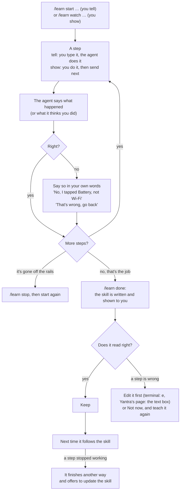

# Tutorial — your own helper, set up in an afternoon

This is for someone who wants a helper on their own computer: one that
can read their email, look at their home, do things later on a schedule,
and remember what they told it. You don't need to know how any of it
works inside. You need a terminal, and about an hour.

If you'd rather understand the parts and wire them yourself, Yantra's
tutorial does that by hand (its §24). This one uses Sarathi to do it for
you.

---

## What you're setting up

Seven small programs, each with one job. You'll use three of them today:

```
   you, in a browser
          │
          ▼
   ┌──────────────┐   reads your mail,     ┌──────────────┐
   │  Yantra's    │   your home ────────▶  │    Setu      │──▶ Gmail,
   │  page        │                        │ (your keys)  │    Home Assistant
   │ (the helper) │                        └──────────────┘
   └──────┬───────┘
          │ "do this every morning"
          ▼
   ┌──────────────┐   at 8:00, asks Yantra to do it,
   │ Samay's      │   and writes down what came back
   │ clock        │
   └──────────────┘

   Sarathi: finds all of these, starts them in the right order,
            and stops them again.
```

| Name | What it is |
|---|---|
| **Yantra** | the helper itself, and the page you talk to it on |
| **Setu** | keeps your sign-ins (Gmail, Home Assistant, …). The helper can *use* an account, but never *sees* its key |
| **Samay** | a clock: "every morning at 8, check my mail" keeps happening while you're away |
| **Sarathi** | the one you install and run: it starts the others for you |

(Dvara, for your helper on your phone and for your family over
Telegram, is Step 6, when you want it. Sparsh, which lets the helper
work an Android phone plugged into this computer, is optional: install
it (its SETUP.md) and Sarathi finds it, and Yantra's page gets a phone
panel. `sarathi phone` turns it on for Dvara too, and on the
containers' road it reaches the phone over Wi-Fi. Smritikosh, a memory
that finds things by meaning, is optional too: Step 7, when the helper
starts forgetting things you told it. And Prahari, which tells you when
something happens — a price drops, a mail comes, Mum messages — is
Step 8. Step 9 keeps good answers as tests, so a new model can't quietly
break them. Step 10 sets up a morning brief. Step 11 keeps a copy of
everything, so a dead disk or a new computer is one command.)

---

## Step 0 · The first choice: whose model answers?

Everything the helper says comes from a **language model**. You have
two choices, and both are fine:

| | **A model on your own computer** | **A model in the cloud** |
|---|---|---|
| Through | Ollama, a free program | Anthropic or OpenAI, with an account |
| Costs | nothing per question | a little per question |
| Your words go | nowhere: they stay on your machine | to the company running the model |
| Needs | a decent graphics card, or patience | an API key (a long password from their website) |
| Quality | good for everyday tasks | the best available |

**If you choose your own computer**, install Ollama
([ollama.com](https://ollama.com)) and pull a model before going on:

```bash
ollama pull qwen3.8:latest
```

**If you choose the cloud**, make an API key on the company's website
and keep it to hand. You'll paste it once, into a hidden prompt.

---

## Step 1 · Get the programs

Sarathi expects the projects to sit side by side in one folder:

```bash
mkdir -p ~/agent && cd ~/agent
for p in yantra setu samay sarathi; do
    git clone https://github.com/kunwarmahen/$p
done

(cd yantra  && uv sync --extra web)     # the page needs its web extra
(cd setu    && uv sync --all-packages)
(cd samay   && uv sync)
(cd sarathi && uv sync)
```

(`uv` is a tool that installs Python programs; if you don't have it:
`curl -LsSf https://astral.sh/uv/install.sh | sh`.)

From here on, `sarathi` means `~/agent/sarathi/.venv/bin/sarathi`. Add an
alias so you can type it short:

```bash
alias sarathi=~/agent/sarathi/.venv/bin/sarathi
```

Check what it can see:

```bash
sarathi status
```

```
yantra      ~/agent/yantra/.venv/bin/yantra  (beside)
            the machine: the agent itself
setu        ~/agent/setu/.venv/bin/setu  (beside)
            the bridge: your accounts, signed in once
            no accounts connected (connect one: setu connect gmail)
samay       ~/agent/samay/.venv/bin/samay  (beside)
            work done later, with receipts
            not running (start it: samay serve); schedules: 0 active, 0 paused
dvara       not found (optional) -- install it, or set SARATHI_DVARA=/path/to/dvara
            many people and agents behind one service
smritikosh  not found (optional) -- install it, or set SARATHI_SMRITIKOSH=/path/to/smritikosh-mcp
            a memory store (Yantra keeps its own without it)

memory: the built-in file (local); `sarathi smritikosh` switches to Smritikosh
```

Each line says **where** it found a program and **how** (`beside` means
"in the folder next to Sarathi"). The line under it is that program
describing itself. "not found (optional)" is fine. The last line says
where the helper keeps what it remembers about you (Step 7).

> **Something says "not found" that isn't optional?** The line tells you
> the fix: install it beside the others, or point Sarathi at it with the
> variable it names.

---

## Step 2 · Connect an account

The helper is more useful when it can see something of yours. Gmail is
the usual first one.

Google asks every program that reads Gmail to have its own "sign-in
client", so the first time there's a one-off step of about ten minutes:
making yours in Google's console. Setu's README walks through it
([*Make your own Google sign-in client*](https://github.com/kunwarmahen/setu#2-make-your-own-google-sign-in-client)).
It ends with a file, `client_secret.json`. Tell Setu where it is, once,
then connect:

```bash
setu=~/agent/setu/.venv/bin/setu
$setu config client-file ~/.config/setu/client_secret.json
$setu connect gmail
```

A browser opens on Google's sign-in page. Sign in and allow it. Setu
asks for **Read only** unless you say otherwise, so the helper can search
and read your mail but not send or delete anything, and Google itself
enforces that. Setu keeps the sign-in in a file only you can read. The
helper only ever sees the email text, never the key.

Setu's README lists the other accounts (Home Assistant, and sites like
Amazon through a browser) and what each level allows.

`sarathi status` now says `1 account connected: gmail:…`.

**One week later, Gmail may stop.** Google expires the sign-in of an app
still in *Testing* every seven days. In its last three days, `sarathi
doctor` (and Settings → Check) warns you with the day it ends, so you can
sign in again before it does. If it ends anyway, you'll see it in `sarathi status`
(`SIGN-IN EXPIRED, sign in again: setu connect gmail --as personal`), in
`setu list`, and from the helper itself when you ask about mail. Run that
command, and the helper has Gmail again on your next message; nothing
needs restarting, containers included. To stop it happening, publish your
Google app once (Setu's README, *Testing mode signs you out weekly*), then
tell Setu with `setu config google-published on` so the warning stops.

**An MCP server of your own** (optional). If you have a server that
speaks MCP (a docs or notes server, a tool someone gave you an address
for), add it to Setu once. Every road then has it: Yantra's page
(within ten seconds, nothing restarted), Telegram and the home page's
chat, containers included. The server
needs one of three things, and it tells Setu which:

* **Nothing.** Give the address:

  ```bash
  $setu connect --server https://example.com/mcp --id docs
  #   connected docs:personal (example.com/mcp) -- All its tools, 6 tools
  ```

  `--id docs` is the name the helper uses for it. Pages and cards show
  the server's own name for itself; to show your own instead, add
  `--name "Team docs"`.

* **A token** (an API key from the server's own settings). If you leave
  it out, the server answers *"asks for a token (HTTP 401); add one with
  --ask-token"*. Add `--ask-token`, and Setu asks for it:

  ```bash
  $setu connect --server https://example.com/mcp --id docs --ask-token
  #   the server's token (not shown):        <- paste it and press Enter
  ```

  You paste it once, here, at your own computer. It's hidden as you
  paste, never goes on the command line, and is kept in Setu's vault.
  The helper in the containers never needs it: Setu adds it to each
  request on its way to the server. If the server wants the token in
  some other header, add `--header X-API-Key` (or the name its docs give).

* **Its own sign-in page** (Linear, Notion, Robinhood and other online
  services). Give the address with no token. A browser opens on the
  service's sign-in, as it did for Gmail. Sign in there, and Setu keeps
  the sign-in and renews it:

  ```bash
  $setu connect --server https://mcp.notion.com/mcp --id notion
  #   https://mcp.notion.com/mcp signs in on its own page. A browser window is opening: ...
  #   connected notion:personal (mcp.notion.com/mcp) -- All its tools, 65 tools
  #     36 of them only read (they may run unasked); the rest are asked about. ...
  ```

  If you are already signed in to the service in that browser, it may
  skip the password and go straight to its own **Allow** page: finish
  that, and the terminal says *connected* by itself. Nothing to copy.
  For an account that can spend money (a trading app), choose *Only its
  reading tools* when Setu asks.

  **From your phone instead:** send `/connect server
  https://mcp.notion.com/mcp notion` to the bot. With `[house]` or a
  window address set, its link shows the service's sign-in page running
  on your computer, as Gmail's does (item 3 in Step 6). If the sign-in
  sends you to another app on the phone (Microsoft Authenticator, a mail
  with a code), the picture comes back when you return; if it shows a
  broken image instead, reload the page. Keep going (choose the
  workspace, **Allow access**) until the page says *Signed in*; the bot
  then says *connected*. The *I've signed in* button only checks: before
  the service has finished, it tells you what's left and closes nothing.

Or do any of these on Setu's page instead: **My accounts** on the home
page, then **Add your own server**, with the address and (if it needs
one) the token in its box. *id* and *shown as* there are `--id` and
`--name`.

---

## Step 3 · Tell Sarathi which model answers

```bash
sarathi init
```

**On your own computer** (choose 1). Sarathi asks Ollama which models
you've pulled and suggests one that can hold a conversation:

```
Which model should answer?
  1) one on this machine, through Ollama -- free, private, needs a GPU or patience
  2) Anthropic's, with an API key
  3) OpenAI's, with an API key
Choose 1, 2 or 3 [1]: 1
Pulled models that can talk:
  1) qwen3.8:latest
  2) gemma4:12b
Choose one [1 = qwen3.8:latest]:
Where should what you tell it be remembered?
  1) Yantra's own file on this computer -- nothing to install
  2) Smritikosh, which finds a memory by meaning, not only its words --
     a database in a container, set up now (about a minute)
Choose 1 or 2 [1]:
wrote ~/.config/sarathi/sarathi.toml
  answering: ollama, qwen3.8:latest
  memory: Yantra's own file (`sarathi smritikosh` switches to Smritikosh)
next: `sarathi up`
```

The last question can wait: press Enter. Yantra's own file is all you
need to start, and Step 7 switches whenever you like.

**In the cloud** (choose 2 or 3). Paste your key when asked. Nothing
shows as you paste, which is on purpose:

```
Choose 1, 2 or 3 [1]: 2
ANTHROPIC_API_KEY (hidden as you type; Enter to skip):
wrote ~/.config/sarathi/sarathi.toml
  answering: anthropic, its default model
  ANTHROPIC_API_KEY saved to ~/.config/sarathi/secrets.env (readable only by you)
next: `sarathi up`
```

To choose a particular cloud model, run it as
`sarathi init --force --provider anthropic --model claude-sonnet-5-5`
instead, or edit the file afterwards.

What it wrote is a short file you can read and change at any time:

```toml
[model]
provider = "ollama"
model = "qwen3.8:latest"

[yantra]
port = 8321

[samay]
on = true
port = 8780

[run]
road = "process"

[memory]
via = "local"
```

(There are a few more tables, each with a comment saying what it does.)
Your key is **not** in it. It's in `secrets.env` beside it, so this file
is safe to show someone if you need help.

---

## Step 4 · Start it

```bash
sarathi up
```

```
samay      up at http://127.0.0.1:8780/#token=…  (pid 3324159)
yantra     up at http://127.0.0.1:8321/  (pid 3324163)
setu       up at http://127.0.0.1:8775/#token=…  (pid 3324170)
sarathi    up at http://127.0.0.1:8760/#token=…  (pid 3324178)
```

Open **http://127.0.0.1:8321/** in your browser. That's the helper. Try:

* *"Anything from my accountant this week?"*
* *"Every weekday at 8, tell me if anything in my mail needs me."*

The second one is a schedule. The helper will say back *when* it will
run and *what* it will do, and wait for your yes before saving it. After
that, Samay's clock does it every weekday at 8, whether or not the page
is open. If a run needs your yes for something you didn't allow up
front (a schedule to turn a light off, say), it asks you on Telegram and
on the home page's chat, rather than giving up. Its own page (the `clock` address above, token included) lists
every schedule and every run.

When you're done:

```bash
sarathi down
```

```
samay      stopped  (pid 3324159)
yantra     stopped  (pid 3324163)
```

`sarathi status` shows, at the end, what `up` started and whether each
one is still running.

**One bookmark for all of it.** The `home` line above is a page that
links every other page: Yantra's, Samay's, Setu's (your accounts, who in
your household has their own page open, the catalog and Setu's
settings) and, once you turn Dvara on in Step 6,
Dvara's (your door: who's on it, every turn your agents took and how
each came in — Telegram, the web, a Samay schedule or the terminal —
their files and schedules, and the questions your agents are asking
you). Open that address and bookmark
it. It shows whether each page is running and opens any of them already
signed in. Its **Memory** card says where the helper keeps what it
remembers about you, and once you've done Step 7 it switches between the
two.

Once Dvara is on (Step 6), the page opens on **Talk to your agents**:
a chat with the agents behind Dvara, filling the window, with no
Telegram needed. The cards are then one click away: the four squares at
the top right open **Your pages**, the gear opens **Settings**, and
**← Back to the chat** (or Escape) brings you back. A reload stays on
the one you were on. What a schedule sends you waits there as a line marked
*Sent to you*, including the answers of schedules you make on Yantra's
page. When an agent wants a yes, a card with **Yes** and **No** appears
under the chat.

Give it a job of a few steps and watch: each step shows as a line while
it runs, then the answer appears as it's written. The buttons under the
chat ask without typing: **Skills** (what your agent has learned, and
anything it offers to keep), **Tools** (what it could use on your last
message), **Schedules**, **Memory**, **Turned down**, **Phone** (if the phone is yours:
its screen now, and what was last done on it), **New chat**, and
**History**. After a job of four
steps or more, an agent whose package has skills may offer to keep how
it was done. Press **Keep** and next time it's one step, for you only.
For a shorter job, press **Learn this** after it to ask for the same
offer.

**Finding an old conversation.** Every conversation you have with your
agents is kept by itself as you talk. You don't have to save anything,
and nobody else in the house can see yours. Press **History** under the
chat: a list of them, newest first. Type a word you remember, like
*boiler*, into the box at the top and the list shrinks to the
conversations that say it, with the word marked. Tap one to read it,
then:

- **Carry on in the chat** puts it back in the chat, and you go on from
  where it stopped.
- **Save as PDF** opens your browser's print window with just that
  conversation laid out; pick *Save as PDF* as the printer.
- **Download** saves it as a Markdown file, which any notes app opens.
- **Send…** (on a phone) opens the phone's share sheet: WhatsApp, email
  and so on.
- **Delete** removes it for good, after asking once. The one you're in
  now can't be deleted: press **New chat** first.

What a shared copy holds: your words, the agent's answers, and the
names of the tools it used. What a tool read (an email, a page, a file)
is left out. An answer that repeated something private still says it,
so read it before you send it.

The same works by typing: `/chats boiler` finds, `/chats 2` goes back
into the second, `/chats export 2` sends it to you as a file,
`/chats delete 2` deletes it, and `/keep test` keeps a good answer as
a test (Step 9). Deleting clears your
history. Your chat window here keeps its own recent lines until they age
out, and the owner's record of what each message cost (`dvara runs`)
keeps them too; that is on purpose, so the owner's record stays whole.

**Teaching it a job, one step at a time.** There are two ways. Pick the
one you'll actually do:

| | `/learn start …`: you **tell** | `/learn watch …`: you **show** |
|---|---|---|
| Who touches the phone | **the agent**; you don't | **you**; the agent doesn't |
| What you send | each step, as a message ("open Coinbase", "tap Portfolio") | **next**, after you've done each step yourself |
| What the agent does | carries out that one step, says what's on the screen, asks what's next | looks at what changed and says what it thinks you did ("I think you opened Coinbase"); you correct it if it's wrong |
| Good for | jobs you can describe in words | jobs easier to do than to describe |

```text
/learn start send a WhatsApp message           /learn watch check my Coinbase portfolio value
open WhatsApp                                  (you open Coinbase)              next
tap Mom                                        (you tap to your portfolio)      next
/learn done      then Keep                     /learn done      then Keep
```

Or press **Teach** in the row of words under the chat: pick *Tell it*
or *Show it*, write what the job is for, and press Start. It sends the
same words for you. While the lesson is open, a bar above the row
shows how far it got, with **Done** and **Stop**. It shows a lesson you
started on Telegram too.

A skill taught on one phone is written for both. It opens the app by
its name, not through the folder you tapped, and it says which phone
it was taught on, so a screen that looks different on the other phone
isn't a surprise.

Don't mix them up: a `start` lesson learns only the steps you *write*,
so steps you do on the phone by hand during it aren't seen and `/learn
done` finds nothing. If you'll touch the phone, use `watch`. `/learn
stop` (or `/learn clear`, or the bar's **Stop**) drops a lesson, and so
does New chat. Telegram takes the same
words.

**Fixing its mistakes.** The agent will sometimes get a step wrong.
In a `watch` lesson it only *guesses* what you did from the screen, and
an iPhone gives it nothing but two screens to compare. You fix it the
same way at every point, in your own words:



* **It guessed wrong** ("I think you typed 'uni'", when that word was
  already there): reply with what really happened, as your next
  message: *"No, I tapped the Google folder, then Gmail. 'uni' was
  already there."* Your correction becomes part of the lesson. The
  write-up reads your words next to the steps, so the skill follows what
  you said, not its guess. In a real lesson a correction like that one
  turned "clear the box" into "clear the box *only if* old text is in it".
* **It did the wrong thing, or more than you said** (a `start` lesson):
  *"That's wrong, go back"* or *"Stop, only do the step I say."* Steps it
  took back are left out of the skill.
* **It went quite wrong:** `/learn stop`, then start again. Nothing is kept.
* **Before saving**, read the skill it shows you. It comes with **Keep** and **Not now**; if a step is wrong, press **Not now** and teach it again.
* **After saving**, write `/skills forget NAME` if it was wrong after all (**Skills** lists yours). If a step stops working later, the agent finishes another way and offers to update the skill, with **Keep** and **Not now**.
* A Send, a Pay or a password still waits for your yes every time the skill runs.


On a phone, the chat takes the whole screen; the icons sit at the top.

To show it something, press the paperclip beside **Send** and pick a
photo or a file (a receipt, a letter from school), then ask about it.
It's kept in your folder with that agent, under `from-you/`, and the
agent can read it again later. A picture is looked at only by a model
that can see (most new local ones can; `ollama show MODEL` lists
"vision"). Otherwise the agent says it can't look. On Telegram, just send
the photo or file to the bot, with your question as its caption.

Voice notes work too: on Telegram, hold the microphone and talk; on the
home page, press 🎤, talk, press it again, then **Send**. A local model
that can hear turns it into words first (Dvara picks the smallest one in
Ollama that lists "audio", such as `gemma4:e4b`; `ollama pull gemma4:e4b`
if you have none). The answer starts with *I heard: "…"*, so you can see
if a name was misheard. Your phone's browser can't record from the home
page over plain `http://` (browsers allow the microphone only on this
computer or over https); Telegram has no such limit.

Talk to it and it talks back. After the written answer comes the same
answer read aloud: a voice note on Telegram, and on the home page it
plays by itself. Every answer on the home page also has **▶ Listen**,
for one you typed. The voice is made on this computer by Piper, a small
voice model (it's in the image on the Podman road; on plain programs,
`pipx install piper-tts` and a voice, as Dvara's TUTORIAL step 29
shows). Code, links and tables aren't read out, and a long answer stops
with "The rest is in the message." To hear every answer, and what's
sent to you unasked like the morning brief, send `/voice always`;
`/voice off` for never; `/voice` says which you have.

**What did it just do?** Under every answer on the home page is a small
**Steps**. Open it to see each tool the agent used for that answer,
when, how long it waited for your yes and how long it ran, and a line
of what came back:

```
1 step · 19s · end_turn
1. web_fetch 18:37:08 · refused (unattended)
→ web_fetch was denied: this session runs unattended …
```

**File for a bug report** saves the whole turn as a file. It holds what
the tools read (a page, a mail), and says so at its top, so read it
before you send it anywhere. Everyone sees only their own answers'
steps. On Telegram, `/steps` says the same in words.

**In Hindi too (or another language).** Out of the box there's one
English voice. To have Hindi answers read in a Hindi voice, add one:

```
sarathi dvara --voices en_US-lessac-medium,hi_IN-pratham-medium
sarathi image && sarathi down && sarathi up     # containers; plain programs: just restart
```

(or **Settings → Sarathi → Dvara → Voices for answers read aloud**, then
the same `sarathi image` line). Now an answer written in Hindi is read by the Hindi voice
and an English one by the English voice, whoever asked. Other voices are
listed at huggingface.co/rhasspy/piper-voices (`hi_IN-priyamvada-medium`
is a second Hindi one). Someone who wants every answer in one voice of
their own sends `/voice use 2`, or you pick it for them under **Their
voice** in Settings → People.

---

**Changing a setting later.** Everything you chose here, and everything
in the steps below, can be changed on the home page, under **Settings**
(the gear at the top right):

* **People**: who may use your agents, which ones, their daily
  allowance, their accounts, their Telegram id.
* **Agents**: each agent's model, tools, memory, accounts and
  instructions. Add one from an example, or remove one. Tools are
  checkboxes: each says what it does and whether it *asks you first* or
  *runs unasked* (open a page in its own browser, remember things about
  you, your schedules, your phone...). Names no box stands for, like
  `amazon_*`, wait under **Advanced**. When the list is long, type in the
box above it (`phone`, say) and only the matching boxes stay. A box you
ticked stays ticked while it's hidden. Under each agent, *Skills its
  people kept* lists what each person's agent learned and how often it
  worked. One with a script has **Make it a tool**: its script runs once
  as a test, and it's kept (for that person only) if the test passes.
  Then the agent does that job in one step. **Stop using as a tool**
  takes it back: the skill stays, as steps the agent reads.
* **Rules**: standing answers for a tool (always allow, always ask,
  never), so you're not asked the same thing twice. One thing no rule
  answers: once a turn has read an email, a page or anything a
  connection returned, a change after it is always put to you, with what
  was read on the card's first line. A line in an email can't give your
  agent orders.
* **Accounts**: Setu's settings, and the rules of each site you added.
* **Sarathi**: the model, Dvara and its bot, notices on phones, your
  phone, ports.
* **Keys**: a cloud key or the bot's token, typed in once and never
  shown back.

Each program checks a change before it's saved and keeps the file
before as a backup, so a mistake is refused, not saved. People, agents
and rules take effect from the next message. A change under Sarathi or
Keys shows **Apply**, which starts everything again with it (about a
minute). Each tab also has **Edit as text**, for the file itself.

## Step 5 (optional) · Plain programs, or containers

Sarathi runs everything two ways, and you can switch back and forth.
Everything in this tutorial works either way, with the same accounts,
schedules and memories.

**Plain programs (what you have now).** `sarathi up` starts the
programs from your terminal session, using your own Chrome and your
own bubblewrap (`sudo apt install bubblewrap` if `setu status` says
connectors aren't walled off). Nothing to build, and a `git pull` in a
project folder is picked up at the next `sarathi up`. But when the
computer restarts they're gone until you run it again, and that
includes Samay, so a schedule set for 8:00 won't run if the machine
rebooted at 7:00.

**Containers.** If you have **Podman** (a program for containers),
Sarathi can run them as containers your computer keeps running:
restarted if they crash, started again when you log in.

```bash
sarathi road podman               # use containers from now on
sarathi image                     # builds the container image (a few minutes, ~2.6 GB)
sarathi up
```

```
units rewritten from sarathi.toml
samay      up at http://127.0.0.1:8780/#token=…  (unit sarathi-samay)
yantra     up at http://127.0.0.1:8321/  (unit sarathi-yantra)
```

Same page, same accounts, same schedules, same memories: the containers
use your files where they already are.

Four things to know on this road:

* **On your own computer's model:** Ollama has to accept connections
  from the containers. Start it with `OLLAMA_HOST=0.0.0.0 ollama serve`
  (or set that in its service settings).
* **Your Yantra `.env` stays behind.** The containers are built from
  what's committed, and `.env` never is. A setting you put there, like
  `OLLAMA_CONTEXT_WINDOW=64000` for a 64k model, goes in `sarathi.toml`
  instead, as `context_window = 64000` under `[model]`.
* **In the cloud:** the key has to be in `secrets.env` (Step 3 puts it
  there). A key you typed into your terminal another way won't reach
  the containers, so Sarathi refuses to start without it rather than
  start a helper that can't answer.
* **Accounts that need a browser** (Amazon, X) work here too: the image
  has its own Chrome. If `up` says your computer's Chrome is newer than
  the image's, run `sarathi image` again; Chrome won't open a sign-in a
  newer Chrome saved.

`sarathi down` stops them, and they come back at your next login. To stop
that too: `sarathi down --remove`.

When the projects get an update (`git pull` in their folders), run
`sarathi image` again and then `sarathi up`: it restarts whatever runs an
older image or older settings, and leaves the rest alone.

**Back to plain programs** any time:

```bash
sarathi road process              # stops the containers and removes their units
sarathi up
```

`sarathi road` on its own says which way you're running.

---

## Step 6 (optional) · On your phone, and for your family

So far the helper lives on one page on your computer. **Dvara** (the
door) puts it on Telegram: you can ask it from your phone, and so can
the people you choose, each as themselves. Each person gets their own
conversations, their own spending limit, and, if you give them one,
their own accounts that they connect themselves. Nobody you didn't list
gets an answer at all.

**First, a bot.** In Telegram, talk to **@BotFather**, send `/newbot`,
and pick a name. It gives you a token (a long line like
`123456:AAE…`). Keep it like a password.

**Then:**

```bash
sarathi dvara
```

```
Which agent should a Telegram bot answer as? greeter
Your bot's token from BotFather (TELEGRAM_TOKEN; hidden as you type): ••••
Dvara is on in ~/.config/sarathi/sarathi.toml: port 8770, a Telegram bot answering as greeter
  made Dvara's own token (DVARA_TOKEN, in secrets.env)
  TELEGRAM_TOKEN saved to secrets.env (readable only by you)
  wrote ~/dvara/actors.toml: you, as the owner (your Telegram id still to add)
  copied dvara's example agents to ~/dvara/agents (greeter, minder, scribe): replace them with your own
```

`greeter` is a small example helper that only talks. It's there to
prove everything works. `minder` checks a web page for you, and can do
it on a schedule you say yes to in the chat. Your own helpers go in
`~/dvara/agents` later (dvara's tutorial shows how).

**Start it:**

```bash
sarathi down && sarathi up
```

```
samay      up at http://127.0.0.1:8780/#token=…
dvara      up on 8770 (no page here; yours is dvara-page, below)
yantra     up at http://127.0.0.1:8321/
```

`sarathi status` asks Dvara itself whether it's serving, so the
dvara line says `door serving …` once it's open, and `door not serving`
if it stopped.

**Let yourself in.** Message your bot. It won't answer yet: it doesn't
know who you are. Then:

```bash
sarathi status
```

```
  dvara      running on 8770 (no page here; yours is dvara-page, below)
         messaged the bot but not in the actors file (telegram id): 8675309
```

That number is you. Open the home page, go to **Settings → People**: the
number is listed under *Messaged your Telegram bot, but not on the
list*. Press **Change** on yourself (`owner`), put the number in
*Telegram ids*, and **Save**. Message the bot again: it answers. (No
restart needed; Dvara rereads its list. If you'd rather edit the file,
it's `~/dvara/actors.toml`, and **Edit as text** at the bottom of the
same tab shows it.)

**No phone handy?** Open the home page (the `sarathi` line `up`
printed). With Dvara on, it has a chat at the top: pick `greeter`, say
hello, and the answer appears a few seconds later. It's the same Dvara
with the same rules, but its own conversation: what you said on
Telegram doesn't carry over. If it says Dvara is running without its
web channel, run `sarathi down` and `sarathi up` (on the Podman road,
`sarathi image` first).

**Your own accounts from your phone.** In **Settings → People**, press
**Change** on yourself and pick *Accounts their agents use*:

* *This computer's accounts (yours)*: the phone and the page share one
  set of sign-ins. Also tick *They may connect and disconnect those from
  the chat*, or `/connect` from the chat answers that the owner looks
  after them, the same as it would for a guest.
* *Their own*: a separate folder, starting empty, that you connect from
  the chat. The safe way to try things first: nothing you do from the
  phone touches the accounts on your computer.

(In the file these are `setu = "~/.local/state/setu"` with `setu_manage =
true`, or `setu = true`.) **My accounts**, at the top of the home page,
opens Setu's page for your own accounts.

Then when Amazon asks for its password again (it does, for its orders
page, after a while), you send `/connect amazon` and sign in in the
window it streams to your phone. Tick *Keep me signed in* there; a
sign-in without it is asked for again sooner. `/lock` still belongs to
the computer, since a passphrase on that folder would lock the page out
too (dvara's note 27).

An agent reads Amazon only if its package asks for it. In **Settings →
Agents**, press **Change** on `minder` and add a line to *Accounts it
needs*:

```
amazon:read                    open, follow, scroll, search, a picture -- never a click or a purchase
```

(In its file, `~/dvara/agents/minder/agent.toml`, that's `needs =
["amazon:read"]` under `[connections]`.)

*A picture* is the site's screenshot: ask *"send me a screenshot of my
Amazon orders page"* and minder takes one, saved in your folder with it,
and sends it with `send_file`, which asks you first (give minder
`send_file` under *Tools it may use* if it doesn't have it).

The need brings Amazon's tools with it; `[tools] allow` doesn't have to
name them. Your home works the same way: `needs = ["amazon:read",
"homeassistant:write"]` lets minder see your lights and switch one, and
switching asks you on Telegram first.

To let minder read **every** account you connect, now and later, put
`*:read` there instead of naming each one: `needs = ["*:read",
"homeassistant:write"]` reads Amazon, X, Gmail, Yahoo and whatever you
add next, and still switches lights. Without it, an account you didn't
name isn't minder's. minder is told so, and says so, rather than trying
your phone instead.

A webmail inbox like Yahoo's opens each message with a script, so
reading it takes one more line, in Setu's file for the site
(`~/.local/state/setu/sites/yahoo.toml`): `script_links = true` under
`[browser]`. With it, minder opens a message the way you would, and
still never presses a button that deletes, sends or moves one (Yantra's
note 128).

Then ask *"What were my last three Amazon orders? Just the titles and
the dates."*

**Try each piece from your phone.** Both ways of running (plain programs
or containers, Step 5) work for all of this. Say `minder` was the agent
you gave the bot:

1. **A schedule.** Send *"check whether example.com is up once an hour,
   and only tell me if it's down"*. It says back when it will run and
   asks if that's right. Say yes. A card arrives with two buttons:
   *New schedule … When: every hour … May use without asking:
   web_fetch*. Press approve. If a card ever comes before you've
   said yes, refuse it: the card is the real yes, and you can always
   ask again.
2. **A record.** Ask for the same with *"…and keep a record in
   uptime-log.txt"*. The card now also lists `write_file`. Later, ask
   *"what does my uptime log say?"*. Every run, and every chat you have
   with that agent, uses the same folder, so it finds the lines the
   schedule wrote. To see a run happen now instead of in an hour:
   `~/agent/samay/.venv/bin/samay run-now <id>` (the id is in the bot's
   answer, or in `samay list`; on containers,
   `podman exec sarathi-samay samay run-now <id>`).
   **A schedule that changes something** works the same way. Say *"turn
   off the stairs light in 5 minutes"* (with Home Assistant connected).
   The card should name the one switch it may use (*call_service — only
   with domain=switch, service=turn_off, entity_id=…*). If instead it says
   in capitals *NOTHING ALLOWED HERE CAN CHANGE ANYTHING*, approve anyway
   or refuse and ask again. Either way, at its time anything nobody
   allowed comes to you here as a Yes/No and waits 30 minutes; it never
   just fails quietly. A run that was refused something says so, with
   how to allow it next time.
3. **Gmail, connected from the chat.** Send `/connect gmail` (or, if
   you asked about mail first, press the **Connect gmail** button under
   the answer: it sends the same word). With `[house]` or a window
   address set (below), the link shows **Google's own sign-in page**,
   running in a browser on your computer, at your phone's size. Sign in
   there as with Amazon below: type in the box at the bottom, then Go.
   When you allow it, the page says *Signed in* and the bot says
   *connected*. Without either, the link is Google's own: sign in on
   your phone, and your phone then tries to open a page at
   `http://127.0.0.1:…` and **fails to load it. That's expected**: copy
   that page's whole address (it contains `code=…`) and send it to the
   bot. Telegram's own browser hides that address, so set `[house]`
   first if you use Telegram. It answers *connected*, and
   `/accounts` lists Gmail. `/disconnect gmail` takes it away again. If
   Gmail stops a week later (Google's limit while your app is in
   Testing), the bot says so when you ask about mail: send `/connect
   gmail` again, and your next message has it back.
4. **Amazon, through a window** (set up below). Send `/connect amazon`.
   The link shows Amazon's real sign-in page, live, at your phone's
   size. Type your email in the box at the bottom and press **Send**: it
   goes into the page's empty box by itself (tap a box on the picture
   first to type somewhere else). Then **Enter**, or just your
   keyboard's Go, which sends and presses Enter in one. The same for
   your password and any code Amazon texts you. Tapping a button on the
   picture (Continue, Sign in) always works too.
   When you're in, the page says so and the bot says *connected*.

If something doesn't answer, `sarathi status` says which piece stopped,
and the end of its log: `~/.local/share/sarathi/logs/door.log` for plain
programs, `journalctl --user -u sarathi-dvara -n 60` for containers.

**Adding someone else** is the same: they message the bot, their number
shows in **Settings → People**, and you press **Add as a new person**
(or **Add a person** for someone who'll only use the home page). Choose
their agents and a daily allowance. Pick *Their own* accounts and they can
connect their own Gmail from their phone by sending `/connect gmail` to
the bot. Their sign-ins are kept on your computer, in a folder of their
own, so you could read them. Tell them that.

**For a child.** On their **Change** form in **Settings → People**,
three boxes besides the allowance:

* **Hours their agents answer**: `07:00-21:00`, on their clock (see
  *Their time zone*, below). Outside them they're told *"I'm not answering now -- your hours
  here are 07:00-21:00"*, and a schedule of theirs set for 2 am doesn't
  run either.
* **Messages a day**: `40`, say. What they send that reaches an agent
  counts; schedules and words like `/memory` don't. On a local model
  money never runs out, so this is the limit that does.
* **Who says yes to changes**: pick yourself, and set *Asking before
  changes* to *Asked before anything changes*. When their agent wants to
  write a file, spend, or change something after reading an email, the
  question comes to **your** Telegram as *"For kid: …"*, with the
  buttons. They can't answer it, and if you don't, it's refused.

*Agents they may use* and *Accounts their agents use* are the other two
limits; give a child an agent made for them.

**Answers read aloud**, on the same form, is for anyone: *When they sent
a voice note* (the usual), *Every answer* (someone who'd rather listen
than read, including a schedule's answer), or *Never*. **Their voice**
is whose: one of the voices this house has. They can change both
themselves with `/voice` and `/voice use`.

**Someone far away.** **Their time zone**, on the same form, is for a
person who isn't where this computer is: type `Europe/London` (the box
suggests every zone as you type). Their agent is told the time where
they are, a schedule of theirs "every day at 7" runs at 7 their time,
and their hours open and close on their clock. Blank is this
computer's. A name that isn't a zone is refused when you Save (Dvara's
notes/66).

**Things everyone should know.** **Settings → Household** is a short
list every agent is told, whoever it's talking to: the wifi, bin day,
where the spare key is. Type one and press **Keep for everyone**. From
your own chat, `/remember for everyone the bins go out Tuesday night`
does the same. When someone else in the house says it, it waits on
that tab (and comes to your chat) for you to **Keep** or not.
`/household` in any chat lists them. Everyone's own memories stay
theirs; this is only for what you'd put on the fridge.

**Amazon or X for them, too.** Those sites can't send a sign-in link;
they're signed in to in a browser on your computer. If you tell Dvara
where its pages can be reached, it sends the person a link that shows
that browser live on their phone, and they sign in by tapping and typing:

```bash
sarathi dvara --window-host <your computer's address>
sarathi up
```

Which address: if everyone is on your home Wi-Fi, your computer's
address there works (`hostname -I` shows it, often `192.168.…`), but
what they type travels as plain web traffic across your Wi-Fi. If you
use **Tailscale**, its address is the safe choice, encrypted and
reachable wherever they are.

The window uses port **8790** (`--window-port` changes it). With the
pages on, more ports open on that address: **8760**, the home page,
where the people in the house sign in (below); **8775**, Setu's page,
which a person reaches with `/accounts page`; and, on the Podman road,
**8791**, the window that page streams when they connect Amazon or X
from it. If your computer has a firewall, a phone gets nothing from
those ports, just a page that keeps loading. `sarathi up` notices ufw or
firewalld and prints the line that opens exactly those ports to your
network:

```text
firewall: ufw is on; if a phone can't open 192.168.1.44 on 8760, 8775, 8790, 8791, open them to your network (once is enough):
  sudo ufw allow from 192.168.1.0/24 to any port 8760,8775,8790,8791 proto tcp
```

Run that line yourself; Sarathi never changes your firewall. To close
them again: `sudo ufw delete allow from 192.168.1.0/24 to any port
8760,8775,8790,8791 proto tcp`.

Your computer runs
that browser, so it handles what they type, their password included:
offer it to people who already trust you with their agent.

**Everything, from any device at home.** The window address opens only
what a phone *needs*. To open every page from your phone or laptop
(Yantra's, Samay's, Dvara's, Smritikosh's dashboard), name your computer
in `~/.config/sarathi/sarathi.toml`:

```toml
[house]
name = "linux-al-ml-beast.local"   # your computer's name + ".local"
```

(`hostname` prints the first part. Or set it under **Settings → Every
page on your home network** on the home page.) Then:

```bash
sarathi down && sarathi up
```

Run `sarathi home`: with the page already running, it prints the link
*on your other devices*, `http://linux-al-ml-beast.local:8760/#token=…`.
Open that on your phone, once. Every
card on it now opens on your phone. The **Yantra** card carries Yantra's
own token, so open Yantra from there the first time on each device.
`sarathi up` prints a longer `ufw` line naming every page's port (8792
among them: the sign-in window for Yantra's page, so **connect** and
**Another site?** there work from your phone too); run it. Dvara's own port and Smritikosh's server and databases stay on this computer. If
your Android phone can't open `.local` names, use the computer's
address in place of the name, in the link and in `name`.

**A chat of their own, without Telegram.** Someone in the actors file
who doesn't use Telegram can talk to their agents on the home page, as
themselves. With the window address set (above), invite them:

```bash
sarathi invite priya
```

```
priya's link, for one device, within 48 hours:
  http://192.168.1.44:8760/#invite=priya.…
They open it and choose a password; after that they sign in with 'priya' and that password, and see their own chat only.
```

Send them that link however you like (a text message, say). It works
once: the phone that opens it first chooses a password, and from then
on they sign in with their name and that password. They see their own
chat and nothing else on the page. It runs with their allowance and
their agents, and you see on Dvara's page what they spent, not what they
said. The home page has a **People in the house** list (behind the gear,
under the Settings tabs) that does the
same with buttons: **Invite** shows the link, **Sign out everywhere**
signs them out on every device. Forgot their password? Invite them
again: the new link lets them choose a new one. `sarathi people` lists
who has signed in.

Signed in, they also see **My accounts**: press it and tap *Open my
accounts page* to see and connect their own accounts (Gmail, say). It
works once, on that phone, for ten minutes, the same as `/accounts page`
in a Telegram chat.

**Notices on a phone, without Telegram.** What a schedule sends waits on
the home page until they open it. To have it show on their phone as
well, turn on ntfy, a small push server that runs in your house:

```bash
sarathi dvara --ntfy
sarathi down && sarathi up
```

On plain programs, install ntfy first (<https://docs.ntfy.sh/install/>);
the containers bring their own. Then, on each phone:

1. Install the free **ntfy** app.
2. Open the home page, signed in, and open **Notices on this phone**.
   Tap *Open your notices in the ntfy app*. If that doesn't open it,
   press + in the app, turn on *Use another server*, and type the
   server and topic the page shows.
3. Ask for something on a schedule (*"in two minutes, tell me a joke"*),
   lock the phone, and wait. The notice arrives as *Your agents*, and
   tapping it opens the home page.

They hear notices while the phone can reach your house (home Wi-Fi).
Keep the topic private: whoever has it can read their notices. If
`sarathi up` prints a firewall line, it now includes ntfy's port, 8793.

**Two things that now happen by themselves.** Once a day Dvara checks
every sign-in, and if Google stopped one, the person whose account it is
gets a message saying so, with what to send to fix it. And when a
conversation goes quiet for half an hour, an agent that remembers sends
what it noticed about you (*"Lives in Raleigh"*), and keeps it only if
you answer `/remember 1`.

**Said no by mistake?** `/remember not 2` means "never offer that
again", and the numbers move as you keep things, so it's easy to turn
down the wrong one. Press **Turned down** under the chat: everything
you said no to, newest first, each with an **Undo**. Undo doesn't keep
it; it puts it back on your list, and `/remember` keeps it from there.
On Telegram it's `/remember declined`, then `/remember undo 1`.

**Pictures and PDFs on Telegram.** A picture your agent sends (a
screenshot, a chart) arrives as a photo in the chat, not a file to open.
`/file NAME` still sends the original. To share a conversation from
Telegram as something any phone opens, send `/chats export 1 pdf` (the
number from `/chats`): Dvara prints it with the Chrome already in its
image, so Hindi and emoji come out right.

To turn Dvara off again: `sarathi dvara --off`, then
`sarathi down && sarathi up`.

If another program on your computer already uses Dvara's port
(8770), `sarathi up` says so and names the setting:
`sarathi dvara --port 8771` (any free number), then `sarathi up`.

**Your helper on your phone itself.** With Sparsh installed (its
SETUP.md), the helper can work your Android phone: read a screen, tap,
type, and ask you before Send, Pay or Delete. The containers can't reach
a USB cable, so they reach the phone over your Wi-Fi.

1. Plug the phone into this computer with USB debugging on (allow it
   on the phone), and let it listen on Wi-Fi. One command finds its
   Wi-Fi address and saves it, on any Android:

   ```bash
   sarathi phone tcpip
   #   the phone listens over Wi-Fi at 192.168.1.160:5555
   #   the phone is on in ~/.config/sarathi/sarathi.toml, over Wi-Fi at 192.168.1.160:5555
   #   next: `sarathi down && sarathi up` (or just `sarathi up`)
   ```

   Or on the home page: **Settings → Sarathi → Your phone → Turn on
   Wi-Fi from the cable**, then **Apply**. The cable can come out
   afterwards. (No cable? Android 11 and later can pair instead:
   *Developer options → Wireless debugging → Pair device with pairing
   code*, then **Pair** on the same card, or `sarathi phone pair ADDRESS
   CODE` and `sarathi phone ADDRESS`.)

2. Restart, so the containers get the address:

   ```bash
   sarathi down && sarathi up
   ```

   It says what's still missing: *"nobody in ~/dvara/actors.toml has
   the phone yet"* (in **Settings → People**, **Change** on yourself,
   tick *Their agents may work the phone*, or, with several phones
   named, the boxes under *Their phones*), or *"minder, the
   agent on Telegram, can't use the phone: its [tools] … leaves out
   "mcp__sparsh__*""* (in **Settings → Agents**, **Change** on
   minder, tick *Your phone (Sparsh)* under *Tools it may use*). The restart matters: before it, the containers
   don't have this computer's key, and the phone asks *"Allow USB
   debugging?"* for a key you don't know. Say no to that one.

3. Try it from the computer, then from Telegram:

   ```bash
   podman exec sarathi-yantra yantra --prompt "On my phone, open Settings and tell me what the Battery row says."
   #   The Battery row in Settings says: "Battery — 98% - charging".
   ```

   Then send your bot the same question.

   Then one that stops for your yes: *"Call 555-0123 from my phone."*
   The bot sends a photo of your phone's screen with the Call button
   ringed in red, then one line (*"tap button "Call (dial)" … On the
   screen: field "555-0123""*) with **approve** and **refuse** under it.
   Press refuse. Nothing is dialled. For a tap only a picture can show,
   like a pin on a map, see Dvara's tutorial §18.

4. A schedule on your phone: ask your bot *"every morning at 8, tell me
   my phone's battery"* and accept the card. If the phone is locked with
   a PIN at 8, the bot asks you to unlock it and waits; with only a swipe
   lock, it just goes. Dvara's tutorial, §18, shows how to test this now
   instead of waiting for 8 o'clock.

5. Leave the phone's screen to Sparsh while the helper works it: it's
   kept on, and your own screen timeout comes back two minutes after the
   last step. For an old phone kept just for the helper, keep it on for
   good:

   ```bash
   sarathi phone --awake always      # or working (the default), or off
   sarathi up
   ```

   And answer on the card, not in words: when the helper is about to
   send something, the question comes with **Yes** and **No** buttons.
   If it asks *"shall I send it?"* in plain words instead, say yes and
   it does the step again and asks with the buttons.

**An iPhone, or both.** The helper can work an iPhone too. It needs a
Mac once a week, to sign a small helper app that runs on the iPhone
(WebDriverAgent); Sparsh's SETUP.md, Part C, goes through it step by
step. Your Android stays set up beside it: whichever phone is plugged
into this computer is the one the helper uses. Put the iPhone away and
plug the Android in, and the next thing you ask goes to the Android,
with nothing to change.

1. Plug the iPhone into this computer and unlock it. Step 2 starts
   WebDriverAgent on it for you. To start it yourself in a terminal
   instead, and watch what it says:

   ```bash
   cd ~/sparsh
   uv run sparsh iphone
   ```

   It also tells Sparsh which apps are on the iPhone (an iPhone won't
   say on its own), and again every 5 minutes while it runs, so *"send
   a WhatsApp message"* finds WhatsApp, and an app you install later is
   found within 5 minutes. After updating Sparsh, `sarathi image` puts
   the new one in the containers.

2. Tell Sarathi, and restart:

   ```bash
   sarathi phone iphone
   #   starting the iPhone, if it isn't running (sparsh iphone)...
   #   the iPhone answers at http://127.0.0.1:8100
   #   the iPhone is on in ~/.config/sarathi/sarathi.toml, beside the Android at 192.168.1.160:5555 (the one that answers is used)
   #     the containers reach it at http://host.containers.internal:8100
   sarathi down && sarathi up
   ```

   Or on the home page: **Settings → Sarathi → Your phone → An iPhone
   → Use the iPhone**, then **Apply**. The first time after an
   iOS update it takes a minute longer: Sparsh fetches the developer
   image that the new iOS needs.

   **Unplugged it, restarted it, or updated iOS?** Plug it back in and
   unlock it. While Sparsh is running, that's all: WebDriverAgent comes
   back by itself. Otherwise press **Use the iPhone** again, or run
   `sarathi phone iphone` or `sarathi up`. Each one starts it again.
   If it says *"couldn't be started"*, the reason follows. The usual
   one, the first time: on the iPhone, Settings → General → VPN &
   Device Management → your Apple ID → Trust. Sparsh's SETUP.md, C6,
   has a table of every message and what to do.

   Started this way, WebDriverAgent runs in the background as its own
   service, `sarathi-iphone` (`systemctl --user status sarathi-iphone`).
   `sarathi down` leaves it running. To stop it: `sparsh iphone --stop`.

3. Try it the same way as step 3 above: the **Your phone** card's
   phone panel shows the iPhone's screen, and
   `podman exec sarathi-yantra yantra --prompt "On my iPhone, open
   Settings and tell me what the Battery row says."` asks the helper.

   Keep the iPhone unlocked while the helper works: Sarathi can't change
   an iPhone's Auto-Lock the way it can an Android's screen timeout. A
   locked iPhone is said as locked. To go back to the Android:
   `sarathi phone tcpip` (or its address), then `sarathi up`.

4. **Try these on your iPhone.** Asking a question and all four below
   have been run on a real iPhone 17; tell us if yours differs. Send
   each to your bot on Telegram (or ask Yantra with `podman exec
   sarathi-yantra yantra --prompt "…"`), with the iPhone unlocked.

   * **Typing.** *"On my iPhone, open Notes, start a new note and type:
     Milk, eggs, bread."* A new note with those words appears in Notes.
     Typing goes to whatever field has the keyboard, so the helper taps
     the note first.

   * **Scrolling a long list.** *"On my iPhone, open Settings and tell
     me the last item at the very bottom of the list."* Settings is
     longer than one screen, so the helper scrolls until the list stops
     moving, then answers with the bottom row's name. Scroll to the bottom
     yourself to check it.

   * **Saying yes to a held step.** *"Text <your own number> from my
     iPhone: hello from the agent."* The helper writes the message, then
     stops before Send: you get the iPhone's screen with Send ringed in
     red and **approve** / **refuse** under it. Press **approve** this
     time. The text arrives on your own phone, and `sparsh log` (in
     Sparsh's folder) lists the send with your yes.

   * **A schedule.** Ask this one on Telegram, the home page chat, or
     Yantra's page. A schedule runs later with nobody watching, so it gets
     the phone only because you can still be asked: Dvara checks the phone
     is free first, and asks you in your chat to unlock it if it's locked. *"Every morning
     at 8, open Settings on my iPhone and tell me what the Battery row
     says."* Accept the card the bot sends.
     Then run it now instead of waiting for 8 (the id is in the bot's
     answer, or in `podman exec sarathi-samay samay list`):

     ```bash
     podman exec sarathi-samay samay run-now <id>
     ```

     The answer comes to your chat. To see the locked-phone question,
     lock the iPhone with its side button first, then run it again: the
     bot asks you to unlock it, and the run goes once you do. An iPhone
     only says *locked* (it can't be woken or swiped from here), so a
     locked iPhone is always asked about. `podman exec sarathi-samay
     samay rm <id>` when you're done, or it runs every morning.

**Several phones, each someone's.** An old Android kept for the helper,
your own iPhone, a phone of someone else in the house: name each, then
say whose it is.

1. Name them. A new phone is plugged in (or reached) when you name
   it. A phone already saved without a name (the iPhone from the steps
   above) is named first, and needn't be plugged in: naming what is
   saved asks nothing of it.

   ```bash
   sarathi phone add iphone iphone http://127.0.0.1:8100   # the iPhone already saved
   sarathi phone add nexus                  # the Android on the cable
   sarathi phone list
   ```

   You should see:

   ```
   the iPhone already saved, named (not asked: it needn't be plugged in)
   ...
   84B7N16128001616 (Nexus_6P), on the cable
   nexus is in ~/.config/sarathi/sarathi.toml: Android at 84B7N16128001616
     give it to someone in Dvara's actors file: phones = ["nexus"] under their [actor.…]
     the containers reach it through this computer's adb (sarathi-adb)
   next: `sarathi down && sarathi up`

   iphone: iPhone at http://127.0.0.1:8100 -- not answering
   nexus: Android at 84B7N16128001616 -- answers
   ```

   *not answering* only means the iPhone's WebDriverAgent isn't running
   right now (start it with `sparsh iphone`, or **Use the iPhone** on
   the home page); the name is kept either way. If you skip naming the
   saved iPhone, `add nexus` stops and prints the command that names
   it, so the iPhone is never dropped.

2. In **Settings → People**, open each person with **Change** and tick
   their phones. The boxes, one per phone (*Their phones (each is one
   person's)*), appear only once phones have names: before that,
   People shows a single box, *Their agents may work the phone on this
   computer*. Each phone is one person's: one ticked for two people is
   refused.

   Then **Apply** (or `sarathi down && sarathi up`). Why a restart:
   naming a phone only writes it into `sarathi.toml`. Yantra, Dvara and
   Samay run in their own containers and are told which phones there
   are (`SPARSH_PHONES`) when `sarathi up` starts them; a running
   container keeps what it was started with. Until the restart, they
   still see the old, unnamed phone, and `/phone nexus` doesn't know the
   name. The home page reads the file afresh, so the boxes show at once;
   the agents use the phones after the restart.

3. Try it: *"Which phones can you work?"* on Telegram. Each person's
   helper names only their own. `/phone` shows the screen of your first
   phone and lists the others (`/phone iphone`). A schedule for someone
   with several phones says which: *"every morning at 8, on my iphone,
   open Settings and read the Battery row"*. One that doesn't is
   skipped with a sentence saying so, never run on whichever phone
   answered.

---

## Step 7 (optional) · A memory that finds things by meaning

The helper remembers things about you: where you live, how you like
answers. Out of the box it keeps them in a small file that matches
**words**. Ask *"find me flights to Austin"* and it won't think of
*"lives near RDU"*, because the two share no word. Smritikosh is a memory
that searches by **meaning**, so it finds it.

You need Podman (Smritikosh keeps its memories in a database that runs
in a container) and, on your own computer's road, Ollama's small model
for meanings:

```bash
ollama pull nomic-embed-text
sarathi smritikosh
```

It takes about a minute and says each thing it does. The lines to look
for:

```
settings   wrote ~/agent/smritikosh/.env: ollama, nomic-embed-text, 768 dimensions
           (the tables are built for 768 now; another embedding model later means an empty database)
database   started smritikosh-postgres (docker.io/pgvector/pgvector:pg17, volume smritikosh-pgdata)
dashboard  built; `sarathi up` starts it on 127.0.0.1:3000
you        account 'asha' and its key (in secrets.env)
memory: smritikosh (in ~/.config/sarathi/sarathi.toml)
```

Then start things again, so the helper uses it:

```bash
sarathi up                  # on the containers' road: sarathi image first, then sarathi up
```

`sarathi status` now ends with a line like `memory: smritikosh at
http://127.0.0.1:8080 -- postgres ok; degraded; 0 remembered for asha`.
**Degraded is fine.** It means Smritikosh's optional extras are left
out, and the helper doesn't use them. To run them anyway (Neo4j, MongoDB
and Redis, about 1 GB more memory), add `--full`: `sarathi smritikosh
--full`, then `sarathi up`. If you already run them for Smritikosh,
they're found and used as they are. `--no-full` leaves them out again.

**Bring across what it already knew.** The old file isn't emptied or
moved. On Yantra's page, type `/memory copy local` once.

Schedules you make at this computer use it too: a morning check that
asks *"what's the weather where I live?"* knows where that is, the same
as the page.

**Try it.** On Yantra's page: `/memory add Prefers a window seat on
flights`, then `/memory find aeroplane seating`. It finds the window
seat, though the two share no word.

**See everything it remembers.** Smritikosh has a page of its own, its
dashboard, and `sarathi up` starts it: open **http://localhost:3000/dashboard/memories**
(the bare `localhost:3000` can open blank),
or **Open Smritikosh's dashboard** on the home page's Memory card
(under **Your pages**, the four squares at the top). Sign
in with your Smritikosh username and password. That's not a key: if you
set Smritikosh up by hand, it's the password you chose then; if Sarathi
made your account, the password is in
`~/.local/share/sarathi/smritikosh-accounts.json`. **Memories** lists what
the helper remembers about you. (The dashboard needs Node.js; without it,
everything else still works.)

**With Dvara on,** everyone in your actors file gets a memory of their
own: their own account and key, so one person's facts never reach
another's helper. You are you there too, so what you told Yantra's page,
your helper on Telegram knows. Someone you add later gets theirs the next
time you run `sarathi smritikosh`. A helper remembers people only if its
package asks for it (`[memory] via = "local"` in its `agent.toml`; with
Smritikosh on, that means Smritikosh).
Each person can sign in to the dashboard as themselves too: their
account is `dvara-<their id>`, and its password is in
`~/.local/share/sarathi/smritikosh-accounts.json`. To give someone an
account you made in the dashboard instead, see the README, "Where the
keys are".

**Changed your mind?** `sarathi smritikosh --off`, then `sarathi up`, or
the **Memory** card on the home page, which does both. Nothing is
deleted either way, and the same card switches back.

**Already set Smritikosh up by hand** (Yantra's SMRITIKOSH.md)? Just run
`sarathi smritikosh`. It finds your setup by its database, and uses your
database, settings and key as they are, making no new account for you.
If you keep it somewhere unusual, say where:
`SARATHI_SMRITIKOSH=/your/path/smritikosh/.venv/bin/smritikosh-mcp sarathi smritikosh`.

---

## Step 8 (optional) · Tell me when something happens

A schedule (Step 4) does something **at a time**: "every morning at
8", "on Friday". Some things you want aren't like that: *"tell me when ALAB drops under $50"*, *"tell me when
a mail from my bank comes"*, *"when Mum messages me on WhatsApp, read it
to me"*. The answer is usually *not yet*, and asking the model every hour
just to hear *not yet* is a waste. **Prahari** waits for you without the
model: it looks with one of the helper's own tools every so often, and
wakes the helper only when the thing happens.

**Which one do I want?** Ask yourself: *is this about a time, or about
something happening?*

| You say | It's | Who does it |
|---|---|---|
| "Every morning at 8, summarise my mail" | at a time | Samay (a schedule) |
| "Remind me on Friday to call the plumber" | at a time | Samay |
| "Tell me when ALAB drops under $50" | waiting for something | Prahari (a watch) |
| "Tell me as soon as the bank writes" | waiting for something | Prahari |

You don't have to remember this. Ask the helper in plain words, and it
picks the right one.

**Get it**, beside the others, and start again:

```bash
cd ~/agent && git clone https://github.com/kunwarmahen/prahari && (cd prahari && uv sync)
sarathi down && sarathi up      # on containers: sarathi image first
```

```
prahari    up at http://127.0.0.1:8782/#token=…  (pid 3324161)
```

**Ask for a watch.** On Yantra's page, or in your chat on Telegram or
the home page:

* *"Tell me when a mail from alerts@mybank.com arrives."*

The helper picks a tool it has that reads (here, the Gmail search),
tries it once, tells you what it sees now, and asks. The card says
exactly what it will run and how often, and when it will tell you. Say
yes. From then on, Prahari searches every 30 minutes or so with no
model, and when that mail comes you get a line in your chat. The first
look only learns what's already there, so you aren't told about the
mail you already have.

A price works the same way: *"tell me when ALAB is under 50"* fires
once when it crosses the line, not every hour while it stays below. If
a site changes its page and the watch can't find the price any more, it
pauses and tells you, and *"fix my ALAB watch"* in the chat mends it.

**Your phone can tell Prahari itself.** On an Android phone, the free
app **MacroDroid** can send Prahari each notification the moment it
arrives, so a WhatsApp from Mum reaches your helper without anything
logging in to WhatsApp:

1. Ask the helper *"when Mum messages me on WhatsApp, tell me"*. It
   makes a watch that *listens*, and says where to send.
2. On Prahari's page (on the home page under **Your pages**), **The
   inlet** shows the address and a key. **Copy the address with its key.**
3. In MacroDroid: trigger *Notification received* (application:
   WhatsApp); action *HTTP request*, method POST, to the address you
   copied with `whatsapp` at the end, content type `application/json`,
   body `{"title": "[notification_title]", "text": "[notification]"}`.

The phone has to reach this computer: with `[house]` (Step 6) the inlet
is on your home network, and `sarathi up` prints the firewall line with
port 8782 in it. Run it once. An iPhone can't do this: it doesn't let
other apps read its notifications.

**Everyone in the house can have watches.** When Asha asks her helper
*"tell me when my bank writes"*, the watch looks with *her* accounts,
never yours. Her phone gets a key of its own too: she asks her helper
*"where does my phone send to?"* and puts that address in her
MacroDroid, so her notifications reach only her watches. To keep
watches to a few people, write their names under `[prahari]` in
sarathi.toml, `people = ["you", "asha"]` (or on **Settings → Sarathi**).

**Mail the moment it lands.** A watch on mail looks every half hour.
To hear sooner, let Prahari keep your mail folder open. Two steps, once:

1. **Add the mail account in Setu.** On the home page, open **Setu**
   under *Your pages*, find the **Mail (IMAP)** card, and fill in the
   mail server (Gmail: `imap.gmail.com`, iCloud: `imap.mail.me.com`,
   Outlook: `outlook.office365.com`), your address, and an *app
   password*. Make the app password in your account's security
   settings, never your real password. Setu checks it with your mail
   server before keeping it, and keeps it with your other sign-ins.
   Call the account `work`.
2. **Tell Prahari to keep it open**, at this computer:

   ```bash
   ~/agent/prahari/.venv/bin/prahari mailbox add work-mail --account mail:work
   ```

   Then `sarathi down && sarathi up` so Prahari starts listening.
   Prahari never keeps the password. It asks Setu each time it connects.

Someone else in your house does step 1 on *their* own Setu page: in
their chat they send `/accounts page` for a link to it (`/connect mail`
sends them there too, so no password is ever typed into a chat). You
do step 2 for them, adding `--for asha`. Now ask
the helper *"tell me as soon as my bank writes, using work-mail"*: a new
mail knocks the moment it lands, and only who it's from and the subject
are read, never the mail itself.

**From outside the house** (for Gmail's own push, or a website that
calls a webhook): put `inlet_port = 8783` under `[prahari]`, run
`sarathi up`, then run Prahari's `deploy/public-inlet-tailscale.sh`
yourself. It gives this computer a public address through Tailscale,
and that address reaches the inlet alone: never the pages, never your
data. Put the address it prints as `public_url` under `[prahari]` and
run `sarathi up` again. Prahari's README has the Google Cloud steps for
Gmail's push.

---

## Step 9 (optional) · Make sure a change doesn't break what works

You will change things: a newer model, a different prompt, a new
connection. Each one can quietly break an answer that used to be right.
You'd only find out the day you need it. So keep a few good
conversations as **tests**, and let them be asked again every night.

**Keep one.** When an answer was right *and you checked it*:

* on Yantra's page: **History** → open the conversation → **keep as a
  test**. Type a few words the answer must say (for example `May 20,
  refund`), or leave it empty;
* on Telegram or the home page chat: send `/keep test May 20, refund`
  right after the answer.

**Check it first.** A test is only as right as the answer it was kept
from. If the kept answer had a mistake, every night will "fail" for
being right.

**Run them every night.** On the home page, open **Your pages**. On the
**Kept tests** card, press **Run them every night**. Samay now replays
them at 3 in the morning with your model. Nothing real happens: no
email is sent and nothing is bought, because every tool answers from
what it said when you kept the test.

**Changed your mind about one?** On the card, **See and delete them on
Yantra's page** lists them all with how each did. **delete** takes one
back (the conversation stays in History). In a chat: `/tests`, then
`/tests delete 2`. To keep an earlier answer rather than the last, use
the small *keep this answer as a test* link under it in History, or
`/chats test 2 turn 1` in a chat.

**What you'll see.** The card shows the last night's result:
*"5 of 6 passed, 1 broke since the run before"*. You get a message in
your chat only when something **broke**. A quiet night means all is
well.

You need the latest image for this (`sarathi image`, then `sarathi down
&& sarathi up`). Until then, Samay says *"runner must be one of direct,
dvara"* when you press the button.

---

## Step 10 (optional) · Your first morning brief

One message every weekday morning: the mail that needs you, today's
calendar, your positions, your to-dos, your phone's battery and missed
calls, and how last night's tests went. It only reads, so it can't send
a mail or place a trade.

1. **Add the agent.** **Settings → Agents**, *New agent from an example*:
   pick **morning**, name it `morning`, **Add**. Then **Settings →
   People → Change** on yourself and tick it under *Agents they may
   use* (or leave *Every agent*).
2. **Connect what it should read** (Step 2): Gmail, Google Calendar,
   Robinhood, Notion, whichever you use. It reads every account you
   connect, read only. What you haven't connected it leaves out.
3. **Ask for it.** Open the bot's chat with `morning` (or the home page
   chat), and say:

   ```
   Send me my morning brief on weekdays at 7:30.
   ```

   It reads the time back (*"every weekday at 07:30 -- next: Mon …"*)
   and asks. Say yes, then press **approve** on the card. From then on
   Samay runs it each weekday and the brief arrives in this chat.
4. **Want one now?** *"Brief me now."*

The phone part reads the battery and missed calls without touching the
screen, so the brief doesn't wait for the phone or ask you to unlock it.
An iPhone tells its battery but not its calls. Last night's tests come
from Step 9's nightly run, if you set one up.

**Which model.** Use `qwen3.8` (or a cloud model). In a trial with only
the phone connected, `qwen3.8-64k` wrote just the phone part every time.
`gemma4:12b` made up tools for the mail and calendar it didn't have,
and wrote *"Mail: tool failed"*.

You need the latest image (`sarathi image`, then `sarathi down &&
sarathi up`): the brief's phone tool and schedules read on a schedule
are new.

## Step 11 (optional) · Keep a copy of everything

Your sign-ins, everyone's conversations, the schedules, the watches,
the phone rules, the skills it learned, its memories and every setting
live in a dozen folders. A disk that dies loses all of them. One command
puts them in one locked file:

```bash
sarathi backup
```

The first time, it asks you to choose a **passphrase**, twice. Only
that passphrase opens your backups, on this computer or any other.
Nobody can get it back for you, so write it down somewhere safe (a
password manager, a card in a drawer). Then it asks each program what it
keeps and writes the file:

```
setu       home           ~/.local/state/setu
samay      state          ~/.samay
...
written: ~/sarathi-backups/sarathi-beast-20261024-023000.sarathi-backup (512.3 MB, 41s), locked with your backup passphrase
```

Browser caches are left out, which is most of the size. A line starting
`NOT IN IT:` means something was left out, and it says why. *"setu
doesn't say what it keeps (an older setu: update it)"* means update that
program and run it again.

**Every night.** **Settings → Check → Back up every night**: Samay
makes one at 02:30, and you hear about it only if a night fails. It
needs no passphrase for this. Only opening a backup does.

**Where they go, and how many.** **Settings → Sarathi**, under
`[backup]`:

```toml
[backup]
folder = "~/sarathi-backups"   # or a USB disk's folder: "/media/you/backup-disk"
keep = 7                       # the newest 7 are kept, older ones removed
also = ["~/keys"]              # anything else of yours to include
```

A backup on the same disk doesn't help when that disk dies. Point
`folder` at a USB disk, or copy the files somewhere else now and then.
Each file is safe to put anywhere: without the passphrase it's noise.

**Putting it back**, on this computer or a new one (a Raspberry Pi):

1. Install the programs (Step 1). A backup holds what's yours, not the
   programs.
2. Stop everything: `sarathi down`.
3. Look first, if you like: `sarathi restore FILE --list` shows what's
   in it and changes nothing.
4. `sarathi restore FILE`, and type the passphrase.
5. `sarathi up` (on the containers' road, `sarathi image` first on a
   new computer).

Anything already in the way is moved aside, never deleted: you'll see
`actors.toml.before-restore-20261024-090000` beside the restored one.
`--only setu,dvara` puts back only those. If Smritikosh isn't on the new
computer yet, the restore says so: clone it where it says, then
`sarathi restore FILE --only smritikosh`.

---

## When something goes wrong

Start with the doctor. It asks every program how it's doing and says
what's wrong, each line with what fixes it:

```bash
sarathi doctor
```

Or on the home page: **Settings → Check → Check everything**. Red needs
fixing, amber is worth a look, green is fine. It changes nothing by
itself. Under a line the page can fix, there's a button (**Start
everything again**, **Rebuild and restart**, **Bring it back**, **Open
Setu's page**). Other fixes, like opening the firewall, you type.

**Check every morning** (next to it) has Samay ask the doctor at 07:30
each day, and you get a message only when something is newly wrong.
Your morning might say *"gmail:personal: Google ends this sign-in Sun
25 Oct"* with what to do, while a phone you left unplugged all week
is mentioned only once.

**Everyone else gets their own check.** Anyone in the house can send
`/doctor` to the bot (or in the home page's chat). They get only what's
theirs, red first, each line with the fix they can use:

```
Your check: 1 amber
🟠 gmail:personal: Google ends this sign-in Sun 22:44
   → sign in again before then: /connect gmail as personal
🟢 $0.12 of your $1.00 today
```

A schedule of theirs that failed this morning, a watch that paused, a
phone of theirs not connected all show there. Nobody sees anyone
else's.

**Restarting in the middle of a job is safe.** Every step of a job is
saved as it happens. If you `sarathi down && sarathi up` (or the
computer restarts) while the agent is six taps into returning a parcel,
each person it was working for gets a message when it comes back:
*"I stopped part way through "return the blue kettle" (6 steps done…).
Send /carry to carry on from there."* `/carry` goes on from the last
step without redoing any, and the agent looks at the screen again first.
Yantra's own page shows a **carry on / leave it** bar. A schedule that
was running carries itself on if the restart came soon after it started;
otherwise its logbook says *interrupted*.

**Seeing what went wrong, step by step.** When an answer isn't right,
look at what the agent actually did. Send `/steps` in the chat for your
last turn: each tool, what it was given, what came back, how long it
took, and who said yes. On Yantra's page, every answer has a **steps**
link. Dvara's page and Samay's page have a **Steps** button on each run.
To report a bug, Yantra's page and Dvara's page (for your own runs) make
a file of it. It holds what the tools read, so look before you send it.

Sarathi also tries to say what happened, and what fixes it, at the
moment it happens. The messages you're most likely to meet:

| You see | What it means | Do this |
|---|---|---|
| `Ollama is not answering at http://localhost:11434` | Ollama isn't running | `ollama serve`, or start the Ollama app |
| `qwen3.8:latest is not pulled yet` | the model isn't downloaded | `ollama pull qwen3.8:latest` |
| `no key for anthropic: run sarathi init or set ANTHROPIC_API_KEY` | no key saved | `sarathi init --force` and paste it |
| `yantra not started: something else is listening on port 8321` | another program uses that port | **Settings → Sarathi → Ports**, change Yantra's, **Save**, **Apply** (or `port` under `[yantra]` in sarathi.toml) |
| `page exited at once (code 2)`, then a few lines | the page stopped as it started | read the lines; `--web needs the web extra` means Step 1's `uv sync --extra web` was missed |
| `clock already running at …, not started by Sarathi: left alone` | you already run Samay's clock another way | nothing: a second clock would run every schedule twice |
| `unknown key clock.onn` | a typo in sarathi.toml | fix the spelling; Sarathi never guesses |
| `that passphrase doesn't open this backup` | a different passphrase, or one chosen later (`--new-passphrase`) | the one you chose when that file was made; older files keep their own |
| `these are running and write into what a restore replaces` | `sarathi restore` with the house up | `sarathi down`, then restore, then `sarathi up` |
| `there is no backup passphrase yet` (from **Back up now** or a night's run) | no passphrase has been chosen | run `sarathi backup` once in a terminal |
| `NOT IN IT: Smritikosh's database isn't running` | the memories' database was stopped | `sarathi up`, then back up again |
| On Telegram the agent says it has no Home Assistant (or Gmail…) and tells you to connect it, though Yantra's page uses it fine | the Telegram agent's package doesn't ask for that account | **Settings → Agents**, **Change** on that agent, add `homeassistant:write` to *Accounts it needs*; there's nothing to reconnect |
| `setu connect --server …` says `asks for a token (HTTP 401); add one with --ask-token` | the server wants an API key, and has no sign-in page of its own | run it again with `--ask-token` and paste the key when asked (Step 2, *An MCP server of your own*), or put it in the token box on Setu's page |
| An MCP server you added in Setu isn't among the boxes under *Tools it may use* | those boxes are Yantra's own tools, Samay and the phone; accounts come another way | nothing to tick: its *Accounts it needs* decides. `*:read` gives the server's reading tools; add `yourid:write` for the rest |
| The agent knows your own server is connected but uses none of its tools | the server marked none of them read-only, so all are `write`, and the agent's need is `:read` | mark the reading ones read on Setu's page (the server's card → **Its tools: which only read**), or `setu site tools yourid NAME=read`; or add `yourid:write` to *Accounts it needs* |
| `/memory` answers that the agent doesn't keep memories, and Telegram's `/` menu has no `memory` | its package doesn't remember people | **Settings → Agents**, **Change**, *Memory*: *Remembers each person*; restart Dvara for the menu (**Apply**, or `sarathi down && sarathi up`) |
| On Telegram the agent reads an email but says it can't open a link in it (a hotel's "View reservation") | the link goes to another site, and the account's tools keep to their own site | ask it what the email itself says (dates, number); to open such links, **Settings → Agents**, **Change**, tick *Open a page in its own browser* (no sign-in there), or tap the address it gives you |
| A sign-in from the chat: after your password the page never loads | that's the expected `http://127.0.0.1…` page, and Telegram's own browser may not show its address | set `[house]` (or a window address) so the sign-in runs in the window and nothing is copied; or open the link in Chrome, then copy the failing page's whole address back into the chat |
| A sign-in window shows a broken image (?) after you went to another app (an authenticator, your mail) | the phone dropped the live picture while that app was in front; the sign-in is still waiting | reload the page on the same phone and carry on; after `sarathi image`, the picture comes back by itself |
| On Telegram the agent ignores a newly connected account (or answers a greeting instead of your question), though `/tools` lists its tools | too many tools for the model's window: a local model then loses the top of the prompt | nothing to tick: past 20 tools each turn sends only the ones your message points at (plus a way to list the rest). Needs `sarathi image` once. **Settings → Agents → Change**, *Tools sent each message*: leave it *Automatic* (*Every tool, every message* turns it off) |
| `no image yet (localhost/sarathi:latest): run sarathi image first` | Podman road, image not built | `sarathi image` |
| a schedule never runs | Samay isn't running | `sarathi status`; on the process road, Samay stops with your session (Step 5 fixes that) |
| `dvara not started: dvara.telegram is set but there is no TELEGRAM_TOKEN` | the bot's token wasn't saved | `sarathi dvara` again, and paste it |
| `dvara not started: no actors file at ~/dvara/actors.toml` | dvara's list of people is missing | `sarathi dvara` writes a starter one |
| the bot never answers you | you're not in the actors file yet | Step 6, "Let yourself in" |
| a link from Dvara (`/accounts page`, a sign-in window) keeps loading on a phone | your firewall drops that port | run the `sudo ufw allow …` line `sarathi up` printed |
| `browser: this machine has Chrome …, the image …` | your Chrome updated itself after the image was built | `sarathi image`, then `sarathi up` |
| *"Your phone locked mid-task"* in the middle of a job | the screen went dark between two steps (a Sarathi from before `[phone] awake`) | `sarathi image`, then `sarathi up`; or `sarathi phone --awake always` |
| a phone question comes as a long numbered list with no photo, or the bot opens Maps' rows one by one | containers from before the picture on every question | `sarathi image`, then `sarathi up` |
| **Settings → People** shows one phone box, not one per phone | no phone has a name yet | `sarathi phone add NAME ...` for each (`sarathi phone list` says *no phones are named* until then), then reload the page |
| *"Which phones can you work?"* names only one phone, or `/phone nexus` doesn't know the name, after `sarathi phone add` | the containers were started before the names, and keep what they started with | `sarathi down && sarathi up` (or **Apply**) |
| the bot says the phone tools "aren't connected" | the agent's `[tools] allow` leaves the phone out | add `"mcp__sparsh__*"` to it; `sarathi phone ADDRESS` says which file |
| a scheduled phone run is `skipped: the phone couldn't be reached` | the phone's address changed, or it restarted (it stopped listening over Wi-Fi) | plug it in, then `sarathi phone tcpip` (or **Settings → Sarathi → Your phone → Turn on Wi-Fi from the cable**); **Apply** if it says so |
| Yantra's phone panel says *No phone yet*, or *not answering over Wi-Fi*, after the phone was switched off and on | the same: a restarted phone stops listening, and its address may move | the same: plug in, **Turn on Wi-Fi from the cable**; then **use this phone** on Yantra's panel |
| `dvara not started: something else is listening on port 8770 (change dvara.port in sarathi.toml)` | another program on your computer uses that port | `sarathi dvara --port 8771` (any free number), then `sarathi up` |
| `I couldn't start that sign-in: the browser did not answer Target.createTarget` | containers from an older Sarathi: the browser had nowhere to write | update Sarathi, then `sarathi up` (it restarts what changed) |
| `I couldn't start that sign-in: no client file at …client_secret….json` | containers from an older Sarathi: Google's client file wasn't mounted | the same: update, then `sarathi up` |
| `dvara cannot start: the image has no dvara` | Podman road, image built without dvara | put dvara's folder beside the others, then `sarathi image` |
| `a Smritikosh database is already here … made with another setup's .env` | your own Smritikosh is somewhere Sarathi didn't look | `SARATHI_SMRITIKOSH=/path/to/smritikosh/.venv/bin/smritikosh-mcp sarathi smritikosh` |
| `SIGN-IN EXPIRED, sign in again: setu connect gmail --as …` | Google expired the sign-in (apps in Testing: every 7 days) | that command; publish your Google app to stop it (Step 2) |
| `mcp server 'gmail-…' exited unexpectedly (code 2)` | an older Yantra hiding the reason (usually the line above) | `setu list` shows the reason; `sarathi image`, then `sarathi up`, for the newer Yantra |
| `dashboard  not built: no npm here` | Node.js isn't installed | install Node.js 20 or newer, then `sarathi smritikosh` again |
| the dashboard signs you in, then shows the login page again | it was opened as `127.0.0.1:3000` | open `http://localhost:3000/dashboard/memories` instead |
| `smritikosh-ui not started: not built yet` | the dashboard was never built | `sarathi smritikosh`, then `sarathi up` |
| `smritikosh-ui not started: its build is older than the last commit to ui/` | a commit or pull changed Smritikosh's dashboard after it was built; `sarathi up` won't serve the old build, so the dashboard stops and the home page says it isn't running | `sarathi smritikosh` (or `npm run build` in Smritikosh's `ui/`), then `sarathi up` |
| `memory.via = "smritikosh" but it isn't set up yet` | sarathi.toml was edited by hand | `sarathi smritikosh` |
| `the cloud road turns memories into numbers with OpenAI, and there is no OPENAI_API_KEY` | a cloud model, and no OpenAI key for Smritikosh's meanings | paste one when asked, or `sarathi smritikosh --local` (Ollama's `nomic-embed-text`) |
| `Smritikosh already has an account 'NAME' and Sarathi doesn't know its password` | an account made by hand, without its key in Sarathi | run `sarathi smritikosh` in a terminal and type its password once |
| `memory: smritikosh, NOT ANSWERING` in `sarathi status` | Smritikosh's server is stopped | `sarathi up` |
| `memory.via is smritikosh, but the image has no Smritikosh` | containers' road, image built before `sarathi smritikosh` | `sarathi image`, then `sarathi up` |
| `ntfy not started: ntfy isn't installed here` | `[dvara] ntfy` on plain programs, with no ntfy | install it (<https://docs.ntfy.sh/install/>), or use the containers' road |
| The phone gets no notices | it can't reach your house's address, the firewall drops 8793, or the topic was typed wrong | home Wi-Fi; run the firewall line `sarathi up` prints; copy the topic from **Notices on this phone** |
| `door did not come up` or `page did not come up`, and its journal says `image platform (linux/arm64/v8) does not match` | the image was built for another machine (an older `sarathi image` after an arm64 build) | `sarathi image`, then `sarathi up` |

Each program also writes down what it printed:
`~/.local/share/sarathi/logs/page.log`, `clock.log` and `door.log` on
the process road; `journalctl --user -u sarathi-yantra` (or `-door`,
`-clock`) on the Podman road.

---

## Where your things are

| What | Where |
|---|---|
| Sarathi's settings | `~/.config/sarathi/sarathi.toml` |
| A cloud key, and Dvara's and bot's tokens | `~/.config/sarathi/secrets.env` (only you can read it) |
| Who may use the bot, and the helpers it offers | `~/dvara/actors.toml`, `~/dvara/agents/` |
| Their conversations, and their own sign-ins | `~/dvara/state/` (each person's past conversations, for **History** and `/chats`: `~/dvara/state/past/<name>.sqlite`) |
| Your sign-ins | Setu's folder, `~/.local/state/setu/` |
| Your schedules and their history | Samay's folder, `~/.samay/` |
| What you're watching for, and what each watch saw | Prahari's folder, `~/.prahari/` (its inlet's key: `inlet.token` there, only you) |
| What the helper remembers about you | `~/.local/state/yantra/`, or with Smritikosh on, its database (the `smritikosh-pgdata` volume) |
| Your conversations on Yantra's page, for its **history** button | `~/.local/state/yantra/conversations.sqlite` |
| Conversations kept as tests, and each night's result | `~/.local/state/yantra/tests/` (yours by agent; each person's under `people/`; last night in `last.json`) |
| Your Smritikosh key, for the helper | `~/.config/sarathi/secrets.env`, as `SMRITIKOSH_API_KEY` |
| Each person's Smritikosh key, for Dvara | `~/dvara/state/memory.json` (only you can read it) |
| Passwords of the Smritikosh accounts Sarathi made | `~/.local/share/sarathi/smritikosh-accounts.json` (only you) |
| Who in the house can sign in to the home page | `~/.local/share/sarathi/people.json` (only you; passwords kept as hashes) |
| What an agent noticed about someone, waiting for their `/remember` | `~/dvara/state/offered.json` (only you) |
| The key each person's ntfy topic is made from | `~/dvara/state/ntfy.key` (only you) |
| Which stopped sign-ins people were already told about | `~/dvara/state/signins.json` (only you) |
| Who chose to hear answers read aloud, and in whose voice (`/voice`) | `~/dvara/state/voice.json` (only you) |
| The voices answers are read in (plain programs) | `~/.local/share/piper/voices/` |
| What Sarathi started, and what each printed | `~/.local/share/sarathi/` |
| Your backups | `~/sarathi-backups/` (or `[backup] folder`); each a `.sarathi-backup` file only your passphrase opens |
| The backups' key (the private half sealed by your passphrase) | `~/.config/sarathi/backup-key.json` (only you) |

Sarathi doesn't move anything: each program keeps its files where it
always has. To start over with Sarathi, delete its two folders; your
accounts, schedules and memories stay (the people in the house would
need inviting again).

---

## Words used here

* **Model** — the part that reads your message and writes the answer.
* **Ollama** — a free program that runs models on your own computer.
* **API key** — a long password a cloud company gives you so your
  computer can use its model. Treat it like a password.
* **Account / connection** — one sign-in Setu keeps, like `gmail:mine`.
* **Schedule** — something Samay asks the helper to do later, or on a
  repeat.
* **Watch** — something Prahari keeps an eye on for you ("tell me when
  the price drops under $50"). It looks with no model, and wakes the
  helper only when the thing happens.
* **Inlet** — Prahari's door for things that can tell it themselves: a
  phone app, a Home Assistant automation, a webhook. Its key can only
  knock, and each person has their own.
* **Mailbox** — a mail folder Prahari keeps open, so a new mail is news
  the moment it lands, not at the next look.
* **Port** — a number that tells your browser which program on your
  computer to talk to (8321 for the page, 8780 for Samay, 8782 for
  Prahari).
* **Container** — a program running in its own sealed box, which your
  computer can restart on its own. Podman is the program that runs them.
* **Bot** — a Telegram account that a program answers instead of a
  person. @BotFather makes one and gives you its token.
* **Actors file** — dvara's list of the people it answers, and what
  each may use.
* **Memory key** — a long password (`sk-smriti-…`) that opens one
  person's memories in Smritikosh, and nobody else's. Sarathi keeps them;
  you sign in to the dashboard with a username and password instead.
